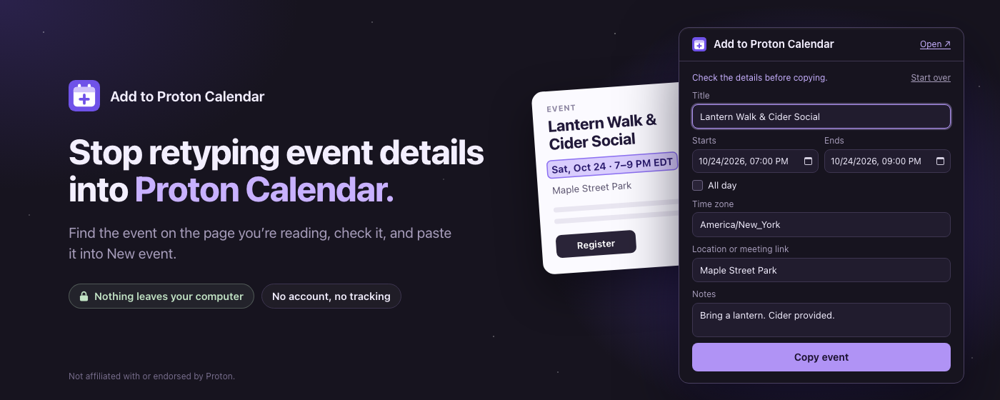
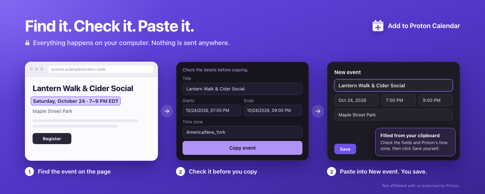
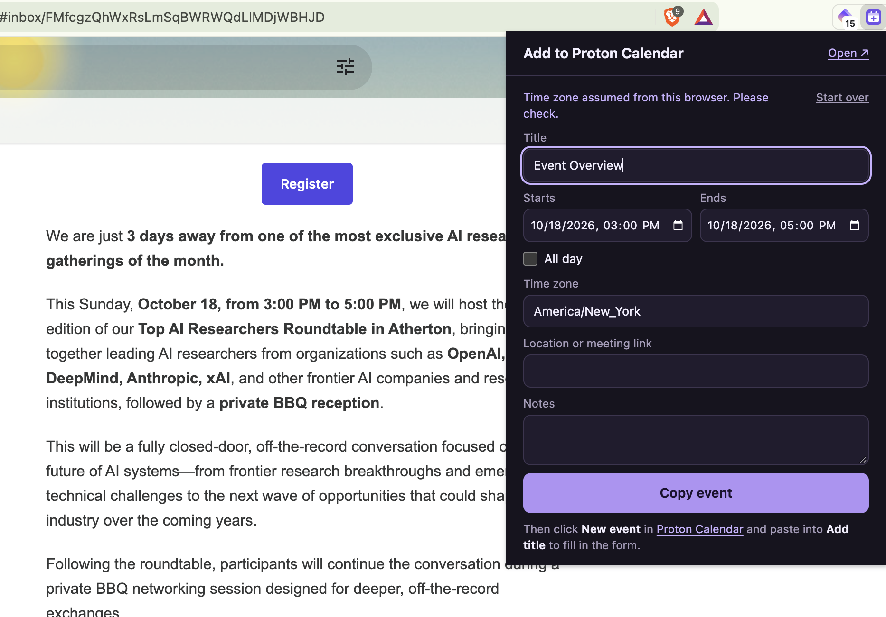
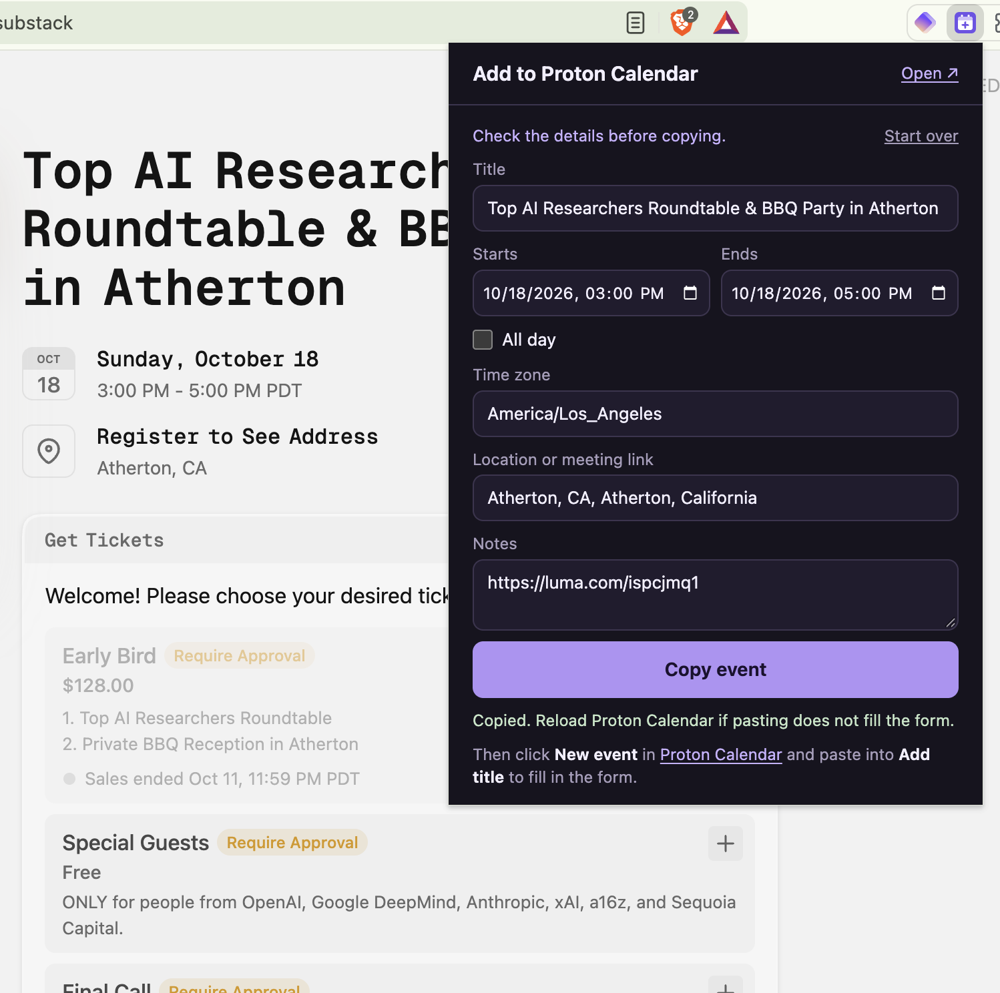
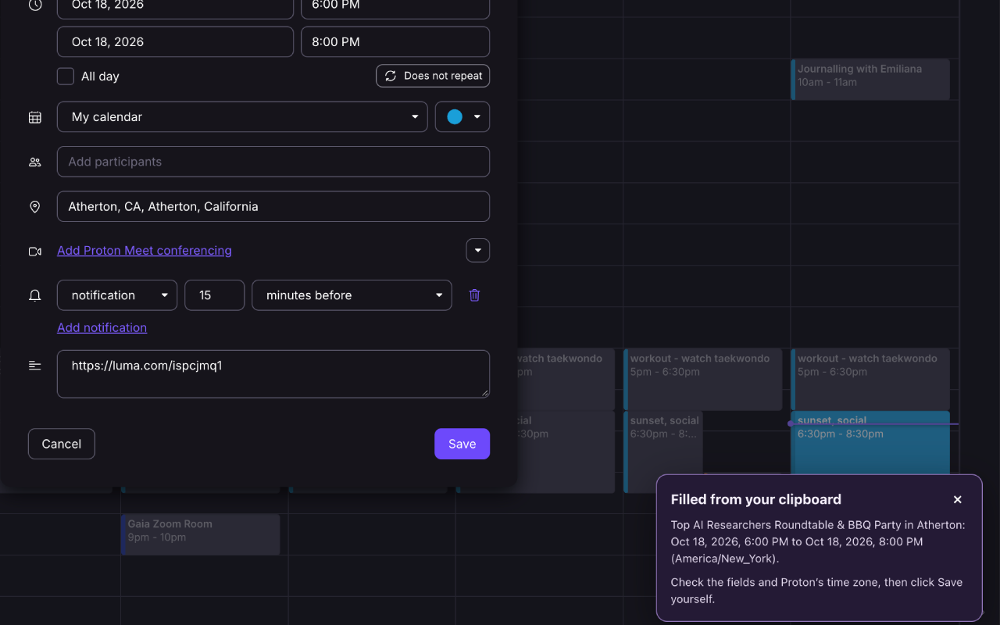
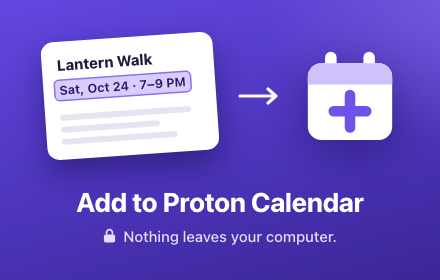
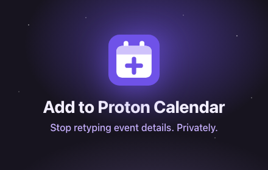

# Add to Proton Calendar



**Stop retyping event details into Proton Calendar.** This small Chrome extension finds events on the page you are reading, lets you review the details, and copies an event you can paste into the calendar's **New event** form. You can also enter the details yourself.

Find → review → copy → paste → save.



**Your information stays on your computer.** The extension reads a page only when you click **Find**, works out the event right there in your browser, and sends nothing anywhere: not to its developer, not to anyone. There is no account, no analytics, no tracking, and nothing is stored. Pages and emails can be personal, so it was built to keep what it reads to itself. [How it protects your privacy](#privacy-and-permissions).

Built by **[Bruce Starlove](https://github.com/brucestarlove)**. Not affiliated with or endorsed by [Proton](https://proton.me/calendar).

## How to use it

1. Open the page or email that shows the event and click the extension icon. On a page with many events, select the text of the one you want first.
2. Choose **Find an event on this page**, or **Enter details yourself** if the date is not recognized. If the page lists several events, pick one from the list.
3. Check the title, start, end, time zone, location, and notes, then choose **Copy event**. Tick **All day** for an event without times.
4. In Proton Calendar, click **New event** and paste into **Add title**. The form fills in, in either the quick popover or the full editor, with Proton's **All day** box ticked or cleared to match.
5. Check the fields and Proton's time zone, then click **Save** yourself. The extension never saves an event for you.

A note in the corner confirms the fill, or names any field Proton did not accept. Anything else you paste into the title pastes normally.

*Example: detecting an event in Gmail*



*Example: detecting an event on an event page*



*Example: pasting the event into Proton Calendar*



## Install from source

1. Download or clone this repository.
2. Open `chrome://extensions` (or `brave://extensions`, `edge://extensions`), turn on **Developer mode**, choose **Load unpacked**, and select the folder.
3. Pin the toolbar icon.

Built for Chromium browsers. Chrome is the release target; confirm Brave or Edge compatibility before relying on those browsers. This repository does not yet include a Chrome Web Store installation link.

## What gets detected

Everything found goes through your review. The extension looks in three places, most reliable first:

- **Event data the page publishes.** Many event and ticketing sites (Eventbrite, Meetup, Luma, and most WordPress event plugins) describe events for search engines with [schema.org](https://schema.org/Event) data. It carries exact times, the venue, and a link back to the event page.
- **"Add to calendar" links.** Google Calendar, Outlook, and Yahoo links in a page or email, including links your mail service wraps in a redirect, carry the title, times, location, and description.
- **The text you can see.** Dates and times are found separately and paired by what sits between them, so these all work:
  - `Saturday, October 24 · 7 - 9pm EDT`, `SAT, OCT 24 AT 7 PM – 9 PM`, `Oct. 29 at 6:30 p.m.`, `Sept. 30, 2027 at 6pm ET`
  - `Thursday 29 October 2026, 18:30 – 20:00 GMT`, `Nov 5th, 6.30-8pm`, `10:00am - 10:30am, Thursday, October 29, 2026`
  - `10/30/2026 7:30 PM`, `30/10/2026 15:00`, `2026-10-29 18:30 UTC`, `Today, 3:00 PM`, `Tonight at 8`, `October 27 at noon`
  - A date on one line with its time on the next, or under `Date` and `Time` labels, or as separate `Starts:` and `Ends:` lines
  - Events over several days: `Fri, Oct 30 · 7:00 PM to Sun, Nov 1 · 5:00 PM EDT`
- **All-day events**, when the page says so: a span of days (`Oct 30 – Nov 1, 2026`, `Nov 5–7`, `5–7 November`, `Dec 30 – Jan 2, 2027`), a date marked `All day`, or published event data and calendar links without times. A date on its own is not offered, because it is far more often a byline or a deadline. Events published as midnight to midnight, a common way sites encode all-day events, are read as all day, and the review says so.
- **Time zones** written after the time: abbreviations (`ET`, `PDT`, `BST`, `CET`, `AEDT`), offsets (`GMT-4`, `UTC+05:30`), names (`Eastern Time`, `Central European Time`), cities (`New York time`, `(London)`), and IANA names (`America/Chicago`). Otherwise your browser's zone is used and the review says so.
- **Location:** a `Where:` or `Location:` line, or a Zoom, Google Meet, Proton Meet, Teams, Webex, Jitsi, Whereby, or similar meeting link, including one that only appears behind a "Join" button.

The page is searched area by area: text you selected, then open dialogs, an open email, readable frames (where Proton Mail shows messages), the main content, and finally the whole page. The first area with an upcoming event wins, so a cookie banner or chat window does not hide the event behind it. Content inside web components (shadow DOM) is read too. When a page lists several events, all of them are offered, best first.

When something is assumed or converted (a one-hour length, the year, the day and month order of `10/05`, the time zone, or a fixed offset converted to your zone), the review step says so. A weekday that does not match its date is pointed out.

Detection looks up to 366 days ahead and reads English. It does not offer past events, events longer than 31 days (it tells you when it found one), recurring events, dates in other languages, or text inside frames from other sites that the browser will not let an extension read. **Enter details yourself** supports timed and all-day events when detection misses the page; create recurring events directly in Proton.

**Found an event it missed?** [Open an issue](https://github.com/brucestarlove/extension-protoncal/issues) with a sanitized date/time example, or send a pull request that adds a row to the formats table in `tests/capture.test.js`. See [Contributing](CONTRIBUTING.md).

## The copied event

The clipboard holds plain text, so it reads fine when pasted anywhere else, and anything that produces the same block (a script, a note, another tool) can be pasted into Proton the same way:

```
Title: New Moon Direction Setting
Start: 2026-10-05T14:00-04:00
End: 2026-10-05T15:00-04:00
Location: https://zoom.us/j/123
Notes: Bring a journal.
```

An all-day event has dates without times, and `End` is its last day, so a one-day event has the same `Start` and `End`:

```
Title: Harvest Fest
Start: 2026-11-05
End: 2026-11-07
```

`Title`, `Start`, and `End` are required, in that order, and `Start` and `End` must both be dates or both date-times. `Location` and `Notes` are optional, and `Notes` runs to the end. Titles and locations are single lines of at most 255 characters; notes can have up to 3,000 characters. A time without an offset (`2026-10-05 14:00`) is read as your browser's local time. Use explicit offsets to avoid ambiguity around daylight saving changes. Invalid dates and blocks over 4,000 characters pass through as ordinary text. Pasting an event also clears an existing location or notes if those fields are empty in the copied event.



## Limits

- **Time zone.** Times are converted to your browser's time zone for the form. That matches Proton unless your Proton calendar uses a different zone, so check it before saving. All-day events have no time zone.
- **Language.** The paste helper supports English month-name date formats (`Oct 5, 2026` or `5 Oct 2026`) and 12- or 24-hour clocks. Numeric dates and unsupported formats are reported so you can finish those fields by hand.
- **Event shape.** The popup creates future events, timed or all-day, up to 31 days long, using years 1970–2037. An all-day event can start today. Date entry rejects ambiguous and nonexistent local times at daylight saving transitions. External clipboard blocks can describe past events, subject to the same duration and date limits.
- **Proton's interface.** Filling relies on Proton's web form selectors, including its **All day** box. If Proton changes its interface, fields may stop filling until the extension is updated. Unit tests simulate the form; verify the quick popover and full editor against live Proton before each release.
- **Browser pages.** Chrome internal pages, store pages, and other restricted pages cannot be read. Enter details yourself on those pages.

## Privacy and permissions

Privacy is the design, not an add-on:

- **Nothing leaves your computer.** The extension makes no network requests of any kind, so neither its developer nor anyone else ever receives your page text or event details.
- **It reads only when you ask.** It can't see the sites you visit. Clicking its icon lets it read just the tab you're on, and it reads that tab only when you click **Find**. The one site it runs on by itself is Proton Calendar, where it waits for you to paste.
- **It keeps nothing.** No account, analytics, tracking, advertising, or remote code, and nothing saved in extension storage. Closing the popup discards its form.
- **You stay in control.** You choose when a page is read, what to copy, where to paste it, and whether to save. It never saves an event for you.
- **You can check all of this.** There are no dependencies and no build step, so the source in this repository is exactly what runs.

Copying writes plain text to your system clipboard, like anything you copy, so clipboard managers may retain or synchronize it. Pasting puts the event into Proton's page, and saving is handled by Proton. Read the full [privacy policy](PRIVACY.md).

| Permission | Why |
| --- | --- |
| `activeTab`, `scripting` | Read the current tab when you click **Find an event on this page**, and only then: selected text, the visible text of likely event areas (up to 30,000 characters each), link addresses in those areas, and event data the page publishes for search engines. |
| `https://calendar.proton.me/*` | Run the paste helper on Proton Calendar, including windows that were already open when you copied. |

The paste helper only looks at text from a user paste into an event's title field, so the extension needs no clipboard-reading permission. It runs on Proton Calendar pages to listen for that paste. A copied event stays on your clipboard until you copy something else.


## Development

No build step and no runtime or npm dependencies. Use Node.js 22 or newer to run the checks. Packaging requires the `zip` command.

- `npm test` runs the unit tests with Node's built-in test runner.
- `npm run check` checks syntax and the manifest.
- `npm run package` writes `dist/add-to-proton-calendar.zip` from an explicit list of runtime files, keeping local notes and launch drafts out of the upload.

After changing code, reload the extension on the extensions page. `calendar-paste.js` is the helper that runs on Proton Calendar and `popup.*` is the toolbar popup. In `lib/`, `page-text.js` reads the page, `find.js` picks and merges what it found, `structured.js` reads published event data and calendar links, `capture.js` reads dates and times in text, `zones.js` resolves time zone names, `time.js` converts time zones, and `clipboard.js` is the clipboard format.

## About and contact

Created and maintained by **Bruce Starlove**.

- GitHub: [brucestarlove](https://github.com/brucestarlove)
- Source: [brucestarlove/extension-protoncal](https://github.com/brucestarlove/Add-to-Proton-Calendar)
- Support and privacy questions: [brucestarlove@gmail.com](mailto:brucestarlove@gmail.com)
- X: [@StarloveDev](https://x.com/StarloveDev)

For vulnerabilities, use the private contact in [SECURITY.md](SECURITY.md).



## License

MIT. Copyright © 2026 Bruce Starlove. See [LICENSE](LICENSE).
